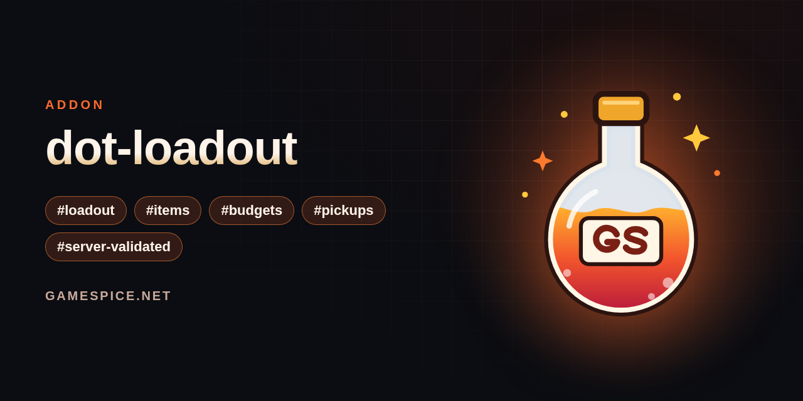

[](https://moddingcommunity.com/a/22-gs-loadout)

What a player takes into a match, as a small document a dedicated server can validate against a schema and the player's entitlements without loading any game content. Also items, slots, optional budgets, stores and deterministic world pickups.

Part of the [**GameSpice**](https://gamespice.net) collection: modular, MIT-licensed building blocks for games on the GameSpice platform (only the TMC website back end is closed). It was built with Claude Code and its headless suite passes, but little of it has met real players yet, so expect rough edges and please report what you find.

## Install

Copy `addons/gs_loadout/` and [GameSpice Core](https://github.com/gamespice-platform/core)'s `addons/gs_core/` into your project and enable both in **Project > Project Settings > Plugins**. gs-core and gs-save are the dependencies.

## Use

```gdscript
# Server: what is this player spawning with?
var res := await loadouts.active_for(user_key)
for entry in loadouts.resolve(res.value):
    arsenal.give(weapon_for(entry["item"]), entry["arsenal_slot"])

# Server: a client sent us a new one.
var published := await loadouts.publish(user_key, submitted)
if not published.ok:
    GSLog.warn("game", "loadout refused: %s" % published.error)
```

## The idea

A loadout maps slot ids to item ids and nothing else: no scenes, meshes or weapon resources. A server receives one from an untrusted client and checks it against a `GSLoadoutSchema` and a `GSLoadoutEntitlements`, on a machine that may have none of the content installed.

## Parts

| Class | What it is |
| --- | --- |
| `GSItem` | One thing a player can take: kind, slots, tags, cost, weight, entitlement. |
| `GSItemCatalogue` | Every item by id, plus an optional client-side resolver that turns one into an asset. |
| `GSLoadoutSlot` | A position and what fits in it (kinds, required tags, forbidden tags). |
| `GSLoadoutSchema` | The slots and catalogue for a game mode. Point and weight budgets are off unless the game or `mp_loadout_budget` sets one. |
| `GSLoadout` | The document. JSON and wire serialisable, with an order-independent digest. |
| `GSLoadoutEntitlements` | What one player may take. Empty by default. |
| `GSLoadoutValidator` | `validate` for input from a client, `conform` for loading from a store. |
| `GSLoadoutStore` | Where loadouts live (memory and local JSON included). |
| `GSLoadoutManager` | Loading, caching, and the one method a client submission goes through. |
| `GSPickup`, `GSPickupField` | Items on the floor. Tick-driven, distance-tested, deterministic. |

## Two defaults worth knowing

- **Nobody owns everything.** Entitlements start empty and `entitlement_source` starts unset, so an unwired server allows only items marked `free`. That is loud and quickly fixed, where the opposite default would silently make every unlock free.
- **A schema change does not lock players out.** `conform` repairs a saved loadout on the way out of a store (retired items are removed, required slots refilled, then budgets trimmed). `validate` refuses on the way in from a client, because a server that repairs client input would accept anything.

Pickups are not `Area3D`s. Respawn timers count ticks and reach is a distance test, so a client can predict a pickup and the server can re-run it identically.

## Test

```bash
godot --headless --path . --import
godot --headless --path . res://examples/loadout_demo.tscn
```

The demo is the suite, runs offline and exits non-zero on failure.

## Licence

MIT. See [LICENSE](LICENSE).
